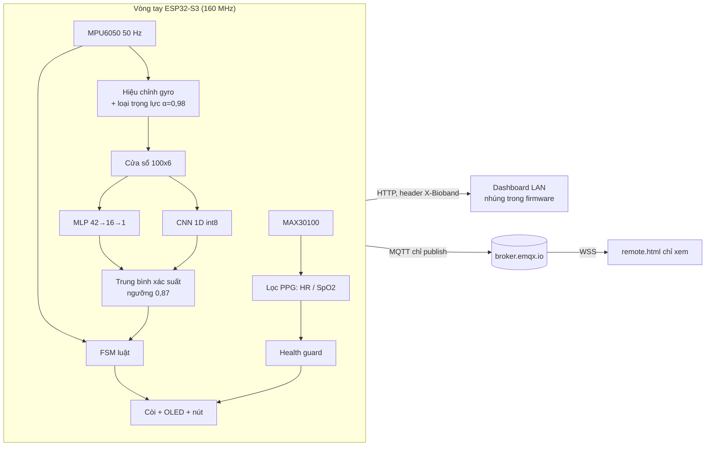
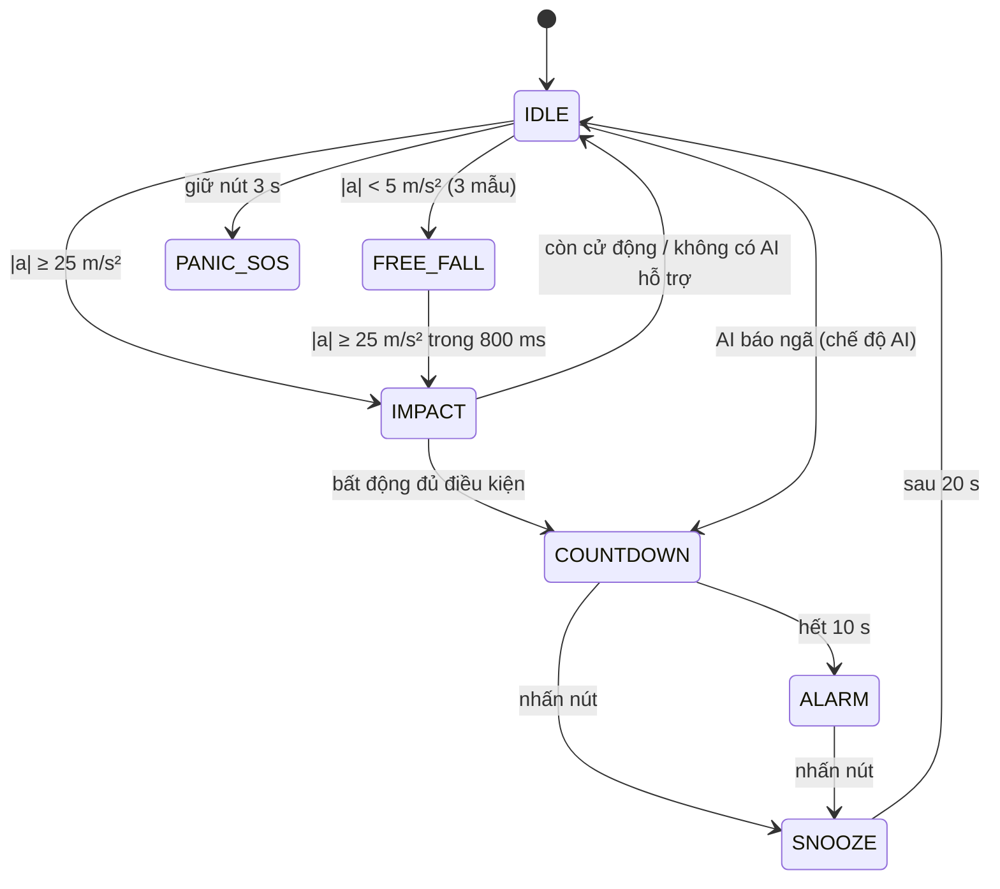

# BIO-BAND — Vòng đeo tay phát hiện té ngã và theo dõi sinh hiệu ứng dụng TinyML trên ESP32-S3

> Tài liệu tổng hợp toàn bộ dự án để đọc, thuyết trình và viết báo cáo dự thi.
> Cập nhật: 2026-11-02. Mọi con số trong mục AI lấy từ các lần chạy lưu trong `dataset/ai_results/` và tái lập được bằng `tools/ai_lab/` (xem `tools/README.md`); bảng đầy đủ nằm ở [`docs/results_tables.md`](docs/results_tables.md), hình ở `docs/figures/`.
> **Đây là sản phẩm nghiên cứu, không phải thiết bị y tế.**

---

## Mục lục

1. [Tóm tắt](#1-tóm-tắt)
2. [Đặt vấn đề và mục tiêu](#2-đặt-vấn-đề-và-mục-tiêu)
3. [Tổng quan hệ thống](#3-tổng-quan-hệ-thống)
4. [Phần cứng](#4-phần-cứng)
5. [Firmware](#5-firmware)
6. [Trí tuệ nhân tạo phát hiện té ngã](#6-trí-tuệ-nhân-tạo-phát-hiện-té-ngã)
7. [Đo nhịp tim và SpO2](#7-đo-nhịp-tim-và-spo2)
8. [Kết nối, dashboard và bảo mật](#8-kết-nối-dashboard-và-bảo-mật)
9. [Kiểm chứng trên thiết bị thật](#9-kiểm-chứng-trên-thiết-bị-thật)
10. [Điểm mới và đóng góp](#10-điểm-mới-và-đóng-góp)
11. [Hạn chế và rủi ro](#11-hạn-chế-và-rủi-ro)
12. [Hướng phát triển](#12-hướng-phát-triển)
13. [Hướng dẫn tái lập](#13-hướng-dẫn-tái-lập)
14. [Phụ lục](#14-phụ-lục)

---

## 1. Tóm tắt

Bio-Band là vòng đeo tay chạy trên **ESP32-S3**. Nó phát hiện té ngã bằng cảm biến quán tính **MPU6050**, đo **nhịp tim và SpO2** bằng **MAX30100**, cảnh báo tại chỗ (còi, OLED, nút hủy) và gửi dữ liệu lên dashboard qua WiFi (LAN) và MQTT (xem từ xa).

Phần trọng tâm là **AI phát hiện té ngã chạy hoàn toàn trên chip**: hai mô hình nhỏ — MLP 42 đặc trưng (705 tham số, float) và **CNN 1D int8** (1761 tham số, 49.200 phép nhân-cộng) — lấy trung bình xác suất. Mỗi 0,5 giây chip suy luận một cửa sổ 2 giây hết **0,42 ms (MLP) + 4,2 ms (CNN)** ở 160 MHz.

Điểm khác với cách làm thông thường là cách **đánh giá**: mô hình học từ dữ liệu cổ tay thật của bộ HIFD (21 người, 349 bản ghi) nhưng được đưa qua **đúng chuỗi xử lý của firmware** (gia tốc thô có trọng lực → lọc 21 Hz → cắt ±16 g → loại trọng lực bằng bộ lọc bậc 1) trước khi huấn luyện và kiểm tra; đánh giá theo **leave-one-subject-out trên 21 người**, tính theo **sự kiện và số lần báo nhầm mỗi giờ**, có khoảng tin cậy 95 %.

| Kết quả chính (21 người chưa từng thấy khi huấn luyện, chuỗi xử lý firmware) | Giá trị |
|---|---|
| Ca ngã phát hiện được ở điểm vận hành đã nạp (ngưỡng 0,87) | **99/104 = 95,2 %** (CI 95 % 0,89–0,98) |
| Báo nhầm ở điểm đó | **0 lần trong 1,95 giờ** sinh hoạt (giới hạn trên 95 % ≈ 1,9 lần/giờ) |
| Ca ngã phát hiện được khi cho phép ≤ 1 báo nhầm/giờ (không phụ thuộc ngưỡng) | 96,2 % |
| Ngưỡng gia tốc 25 m/s² đơn thuần | 104/104 ca ngã nhưng **98 báo nhầm/giờ** |
| Máy trạng thái luật gốc của firmware | chỉ 6/104 ca ngã (xem 6.7) |
| Độ trễ từ va đập đến quyết định | trung vị ≈ 0,2 s (replay đầu-cuối trên chip: 0,03–1,4 s) |
| Chip so với numpy (1942 cửa sổ thật gửi qua USB, mô hình cuối) | sai lệch xác suất ≤ 1,6·10⁻⁴; **0 quyết định lệch** |
| Phát lại bản ghi thật vào firmware (cả chuỗi cảm biến → AI → FSM, 50 Hz) | báo động bằng AI: **5/5 ca ngã** (luật gốc: 0/5); 1/4 hoạt động sinh hoạt báo nhầm (vỗ tay) |

**Báo động bằng AI là công tắc runtime, mặc định TẮT.** Các số trên đo trên dữ liệu công khai; chưa thử trên người đeo Bio-Band, nên trong firmware AI chỉ được phép kích báo động khi người dùng bật (xem 6.8 và 11).

---

## 2. Đặt vấn đề và mục tiêu

- Té ngã là nguyên nhân hàng đầu gây chấn thương ở người cao tuổi; nguy hiểm nhất là khi **không ai biết** người đó đã ngã.
- Ngưỡng gia tốc đơn giản rất dễ **báo nhầm** (vỗ tay, ngồi phịch xuống ghế, đặt mạnh tay xuống bàn). Trong thí nghiệm của chúng tôi, ngưỡng 25 m/s² bắt 100 % ca ngã nhưng báo nhầm 98 lần/giờ sinh hoạt.
- Máy trạng thái luật "rơi tự do → va đập → bất động" giảm báo nhầm nhưng đòi người ngã nằm yên ngay lập tức; với dữ liệu thật điều này sai (6.7).

**Mục tiêu:** (1) vòng tay chi phí thấp phát hiện ngã và đo HR/SpO2; (2) AI chạy trên chip để giảm báo nhầm mà vẫn giữ tỉ lệ phát hiện cao; (3) cảnh báo tại chỗ có nút hủy; (4) đánh giá trung thực: chia theo người, không dùng dữ liệu kiểm tra khi chọn mô hình, nêu rõ hạn chế.

---

## 3. Tổng quan hệ thống



- **Core 1:** vòng cảm biến 50 Hz (MPU6050, MAX30100, FSM, AI, còi, OLED). **Core 0:** WiFi, HTTP, MQTT. Hai lõi trao đổi qua mutex và hàng đợi lệnh.
- Phát hiện và báo động **không phụ thuộc mạng**; MQTT chỉ để xem từ xa.

---

## 4. Phần cứng

| Ký hiệu | Linh kiện | Vai trò |
|---|---|---|
| U1 | ESP32-S3 Super Mini (4 MB flash, 2 MB PSRAM) | MCU 2 lõi, WiFi 2,4 GHz |
| U2 | GY-MAX30100 (part ID 0x11) | PPG đỏ + hồng ngoại → HR, SpO2 |
| U3 | OLED SSD1306 0,96" | Hiển thị |
| U4 | MPU6050 (±16 g, ±2000 °/s) | Gia tốc và con quay |
| U5, U6 | Pin LiPo + TP4057 | Nguồn và sạc (chưa hàn) |
| U7, U8 | Còi active, nút nhấn | Báo động, hủy / SOS |

| Chức năng | GPIO | Ghi chú |
|---|---|---|
| I2C SDA / SCL | 8 / 9 | 100 kHz: OLED 0x3C, MPU6050 0x68, MAX30100 0x57 |
| Nút ngoài | 2 | Active-low; đang đọc LOW khi nhả (lỗi dây) → dùng nút BOOT (GPIO0) dự phòng |
| Còi | 3 | HIGH = kêu |
| ADC pin | chưa gán | Chờ hàn cầu phân áp |

---

## 5. Firmware

C++ trên Arduino-ESP32 + PlatformIO; mã trong `src/`, `include/`.

| File | Chức năng |
|---|---|
| `main.cpp` | Khởi tạo, hiệu chỉnh gyro, vòng lặp 50 Hz, chế độ hardware-in-the-loop qua USB |
| `sensors.cpp` | MAX30100 (FIFO, lọc PPG), đếm bước, đo pin |
| `fsm.cpp` | Máy trạng thái té ngã, đường AI, health guard |
| `ai_model.cpp`, `ai_cnn.cpp` | Loại trọng lực, đặc trưng, MLP, CNN int8, self-test |
| `controls.cpp`, `display_ui.cpp`, `storage.cpp` | Nút/còi/lệnh, OLED, NVS |
| `web_api.cpp`, `mqtt_link.cpp` | WiFi + cấu hình WiFi, HTTP, MQTT (chỉ publish) |

### 5.1 Máy trạng thái và hai chế độ



- **Chế độ AI TẮT (mặc định):** chỉ đường luật kích báo động; AI vẫn tính và gửi xác suất.
- **Chế độ AI BẬT:** (A) tổ hợp AI ≥ 0,87 → đếm ngược ngay; (B) đường luật dùng hằng số hiệu chỉnh lại (ổn định 1,5 s, cửa sổ 2 s, phương sai < 0,8) nhưng phải có AI hỗ trợ (p ≥ 0,5 trong 6 giây gần nhất). Cooldown 30 giây sau mỗi lần AI báo.

---

## 6. Trí tuệ nhân tạo phát hiện té ngã

### 6.1 Dữ liệu: HIFD

| Thuộc tính | Giá trị |
|---|---|
| Nguồn | HIFD — *Heart Rate & IMU sensor data for fall detection*, IEEE Access 2020 ([GitHub](https://github.com/nhoyh/HR_IMU_falldetection_dataset)) |
| Người / thiết bị | 21 người (13 nam, 8 nữ), cảm biến ở **cổ tay trái**, 50 Hz |
| Bản ghi | 349 file `.mat`, 381.394 mẫu: 104 bản ghi ngã, 245 bản ghi sinh hoạt (đi, cầu thang, giường, ghế, vỗ tay, ăn, chải tóc, đánh răng, mặc áo, đi giày, kéo khóa, rửa tay, viết) |
| Tín hiệu dùng | gia tốc (đã **loại trọng lực** bởi tác giả), con quay (°/s → rad/s), **quaternion** |

### 6.2 Từ dữ liệu công bố đến những gì chip thật sự thấy

Firmware nhận gia tốc **thô có trọng lực**, qua bộ lọc số của MPU6050 (21 Hz) và tự loại trọng lực bằng bộ lọc thông thấp bậc 1 (α = 0,98, hằng số thời gian ≈ 1 s). Dữ liệu HIFD công bố đã bỏ trọng lực theo cách khác. Để huấn luyện và kiểm tra trên đúng tín hiệu của chip, `tools/ai_lab/preproc.py` dựng lại chuỗi này:

1. Gia tốc thô = gia tốc tuyến tính + trọng lực trong hệ cảm biến, tính từ quaternion (`g_s = Rᵀ[0,0,g]`).
2. Lọc thông thấp bậc 2 tại 21 Hz → cắt ±16 g (gyro ±2000 °/s) → loại trọng lực bằng bộ lọc α = 0,98, **giống từng dòng trong `ai_model.cpp`**.
3. Tùy chọn (tăng cường dữ liệu): xoay ngẫu nhiên hệ trục ±30° và cộng độ lệch zero-rate gyro ±0,15 rad/s.

*Giả định cần nêu:* quy ước của quaternion HIFD không được tài liệu hóa. Kiểm tra bằng cách so đạo hàm của vector trọng lực với `−ω × g` từ gyro: cosin trung vị = **−0,50** (world→body) so với **0,03** (body→world), nên chọn world→body; kết quả chưa tuyệt đối chắc chắn, vì vậy phần xoay ngẫu nhiên đóng vai trò bảo hiểm.

**Khoảng cách miền đo được.** Mô hình MLP đã nạp trước đây (huấn luyện trên HIFD nguyên bản, 3 người test 19–21): 14/15 ca ngã với cửa sổ recall 0,918 trên tín hiệu công bố; trên tín hiệu qua chuỗi firmware, 15/15 ca ngã nhưng cửa sổ recall tụt còn 0,869. Trên toàn bộ 21 người (LOSO): huấn luyện trên tín hiệu công bố rồi kiểm tra trên tín hiệu firmware cho **92/104** ca ngã; huấn luyện trên tín hiệu firmware cho **97/104**; thêm tăng cường dữ liệu cho **98/104**.

### 6.3 Gán nhãn theo sự kiện (event-centered labeling)

Mỗi bản ghi ngã dài ~15–20 giây nhưng cú ngã chỉ chiếm 1–2 giây. Nếu gán nhãn "ngã" cho **mọi** cửa sổ của bản ghi ngã thì đoạn đứng yên trước và nằm yên sau (về vật lý giống nằm giường, ngồi ghế) cũng bị coi là ngã.

```
mag[i] = |a_tuyến tính|;  p = argmax(trung bình trượt 5 mẫu của mag)    # tâm va đập
Cửa sổ "ngã":        |tâm cửa sổ − p| ≤ 1,0 s
Cửa sổ "sinh hoạt":  nằm hoàn toàn ngoài p ± 1,5 s;   vùng 1,0–1,5 s bị loại
```

Chỉ áp dụng cho bản ghi ngã (mỗi bản ghi đúng một cú ngã, đã kiểm tra cả 104); không tạo nhãn "ngã" nào mới. **Ablation cho thấy đây là yếu tố quyết định:** bỏ nhãn theo sự kiện, tỉ lệ phát hiện (cùng quy trình đánh giá) rơi từ 97/104 xuống **18/104**.

### 6.4 Đặc trưng và mô hình

- **MLP-42:** 42 đặc trưng thống kê (mean, std, min, max, rms, mean|x| cho 6 trục; mean, std, min, max, đỉnh, phương sai 0,5 giây cuối của độ lớn gia tốc) → 16 tanh → 1 sigmoid. 705 tham số. Đặc tả: `tools/hifd_features.md`.
- **CNN 1D int8:** đầu vào 7 kênh × 100 mẫu (6 trục + độ lớn gia tốc), `Conv(7→8,k5,s2) → Conv(8→16,k5,s2) → Conv(16→16,k3)`, ReLU, max + mean theo thời gian, Dense → sigmoid. **1761 tham số, 49.200 phép nhân-cộng.** Lượng tử hóa sau huấn luyện: trọng số int8 theo kênh, kích hoạt int8 theo lớp (hiệu chuẩn bằng bách phân vị 99,9), tái lượng tử hóa bằng số thực. Sai lệch xác suất trung bình giữa float và int8: 0,0015.
- **Tổ hợp:** trung bình xác suất của MLP và CNN; quyết định "ngã" khi ≥ 0,87.

### 6.5 Giao thức đánh giá

- **Leave-one-subject-out** trên 21 người: mỗi lần giữ lại một người để kiểm tra, ba người khác (chọn cố định theo hạt giống) dùng để dừng sớm; 17 người còn lại huấn luyện. 1–3 hạt giống mỗi mô hình.
- **Đơn vị đánh giá là sự kiện**, không phải cửa sổ: một ca ngã được phát hiện nếu có cảnh báo với tâm cửa sổ trong ±2 s quanh va đập; mọi cảnh báo khác là **báo nhầm** (gộp các cảnh báo cách nhau < 3 s). Tổng thời gian đánh giá **1,95 giờ**, nên 1 báo nhầm ≈ 0,51 lần/giờ.
- Khoảng tin cậy 95 %: Wilson cho tỉ lệ phát hiện, Poisson chính xác cho số báo nhầm/giờ.
- Ngưỡng của mô hình tổ hợp chọn trên **điểm số ngoài mẫu gộp của 21 người**: ngưỡng **cao nhất** còn giữ tỉ lệ phát hiện ≥ 95 % với ≤ 1 báo nhầm. Vì ngưỡng được chọn trên chính dữ liệu dùng để báo cáo, khoảng tin cậy của điểm vận hành hơi lạc quan.

### 6.6 Kết quả

Bảng đầy đủ: [`docs/results_tables.md`](docs/results_tables.md). Các cột "@ ≤ k báo nhầm/giờ" không phụ thuộc ngưỡng.

| Mô hình (LOSO, 21 người) | Tham số | @ ≤1/h | @ ≤2/h | @ ≤5/h |
|---|---|---|---|---|
| Hồi quy logistic | 43 | 0,00 | 0,00 | 0,913 |
| Cây quyết định (độ sâu 6) | – | 0,00 | 0,00 | 0,529 |
| Random forest (60 cây) | – | 0,837 | 0,875 | 0,904 |
| MLP-42, huấn luyện trên HIFD nguyên bản | 705 | 0,827 | 0,865 | 0,923 |
| MLP-42, dữ liệu qua chuỗi firmware | 705 | 0,846 | 0,913 | 0,962 |
| MLP-42, chuỗi firmware + tăng cường (3 seed) | 705 | 0,942 | 0,942 | 0,971 |
| MLP-30, đặc trưng bất biến theo hướng | 513 | 0,904 | 0,923 | 0,971 |
| CNN nhỏ (4-8-8) | 529 | 0,00 | 0,00 | 0,923 |
| CNN (8-16-16), chuỗi firmware (3 seed) | 1761 | 0,885 | 0,933 | 0,990 |
| CNN (8-16-16) + tăng cường (3 seed) | 1761 | 0,904 | 0,933 | 0,990 |
| CNN lớn (16-32-32) | 6337 | 0,00 | 0,00 | 0,933 |
| **Tổ hợp MLP + CNN** | 2466 | **0,962** | **0,971** | **0,981** |

**Điểm vận hành đã nạp (ngưỡng 0,87):** 99/104 ca ngã (CI 95 % 0,89–0,98), **0 báo nhầm trong 1,95 giờ** (giới hạn trên 1,9/giờ). Bỏ sót: `s01/fall1`, `s03/fall1`, `s14/fall4`, `s17/fall4`, `s21/fall3`. Mô hình đơn ở ngưỡng 0,9: MLP 98/104 (3 báo nhầm), CNN 97/104 (3 báo nhầm) — tổ hợp tốt hơn cả hai. Báo nhầm còn lại của các mô hình đơn gần như luôn là **vỗ tay** (xem `docs/figures/fig_operating_curves.png`, `fig_probability_timelines.png`).

**Nhận xét:**
- Huấn luyện trên tín hiệu qua chuỗi firmware thay vì tín hiệu công bố cải thiện rõ (0,865 → 0,913 → 0,942 ở ≤ 2 báo nhầm/giờ), và tăng cường xoay/độ lệch gyro cải thiện thêm.
- Đặc trưng bất biến theo hướng giảm báo nhầm (1,0/giờ) nhưng không vượt tổ hợp; CNN lớn hơn không tốt hơn CNN 1761 tham số → mô hình nhỏ đủ cho dữ liệu hiện có.
- Với khoảng 1,95 giờ dữ liệu sinh hoạt và 104 ca ngã, các chênh lệch dưới ~3 ca ngã hoặc ~2 báo nhầm **không có ý nghĩa thống kê**; xếp hạng giữa các biến thể gần nhau (MLP / CNN / tổ hợp) chỉ mang tính gợi ý.

### 6.7 Máy trạng thái luật và hợp nhất luật + AI

Mô phỏng nguyên văn `updateFallDetection()` của firmware trên HIFD (`evalx.simulate_fsm`):

| Luật | Ca ngã phát hiện | Báo nhầm/giờ | Trễ |
|---|---|---|---|
| Ngưỡng ≥ 25 m/s² | 104/104 | 98,3 | 0,08 s |
| FSM với hằng số gốc (bất động 3 s, phương sai < 0,08) | **6/104** | 7,8 | 6,4 s |
| FSM hiệu chỉnh (ổn định 1,5 s, cửa sổ 2 s, phương sai < 0,8)\* | 31/31 | 18,1 | 3,4 s |
| AI tổ hợp (ngưỡng 0,87)\* | 29/31 | 0 | 0,26 s |
| FSM hiệu chỉnh **VÀ** AI \* | 29/31 | 0 | 3,4 s |
| **AI HOẶC (FSM hiệu chỉnh VÀ AI ≥ 0,5)**\* — cài trong firmware | **31/31** | 2,0 (1 trong 0,5 giờ) | 0,28 s |

\* Người 16–21 (31 ca ngã, 0,5 giờ); hằng số FSM chọn trên người 1–15.

**Phát hiện quan trọng:** trong HIFD, người ngã **vẫn cử động** sau va đập (phương sai của |a| trong 0,2–3,2 giây sau va đập có trung vị 3,7 (m/s²)²; chỉ 1 % ca ngã dưới 0,08 và 17 % dưới 0,8), trong khi 12 % đoạn sinh hoạt 3 giây lại có phương sai dưới 0,08. Điều kiện "bất động 3 giây" của FSM gốc vì vậy gần như không bao giờ thỏa với ngã mô phỏng (người ngã tự đứng dậy), nhưng có thể phù hợp hơn với người bất tỉnh thật — dữ liệu này không kiểm chứng được. Hợp nhất cho kết quả tốt nhất khi **AI là tín hiệu chính** (nhanh, ít báo nhầm) và đường luật chỉ được dùng khi có AI hỗ trợ.

### 6.8 Ablation (MLP-42, 1 seed, ngưỡng theo từng fold)

| Biến thể | Ca ngã phát hiện | Báo nhầm / 1,95 giờ |
|---|---|---|
| Công thức cuối | 97/104 | 14 |
| Bỏ nhãn theo sự kiện | **18/104** | 4 |
| Bỏ trọng số hard-negative (giường/ghế) | 94/104 | 12 |
| Bỏ trọng số lớp | 93/104 | 4 |
| Bỏ đặc trưng 41 (phương sai 0,5 s cuối) | 94/104 | 13 |

Chỉ biến thể đầu tiên khác biệt rõ ràng; ba biến thể còn lại nằm trong nhiễu của một seed.

### 6.9 Triển khai trên chip

| Tài nguyên | Giá trị |
|---|---|
| Thời gian suy luận (160 MHz) | MLP **0,42 ms** + CNN **4,2 ms** mỗi 0,5 giây (≈ 1 % CPU) |
| RAM | cửa sổ 2,4 KB + đệm CNN ~2 KB |
| Flash | trọng số MLP ~3 KB, CNN ~2 KB; fixture self-test ~14 KB |
| Kiểm thử khi khởi động | `[SELFTEST] PASS`: 6 cửa sổ cố định, chip khớp numpy (sai lệch < 10⁻⁴) |

---

## 7. Đo nhịp tim và SpO2

- **Driver:** MAX30100lib, 100 Hz; BeatDetector và SpO2Calculator của thư viện. LED 11 mA / 11 mA (50/27 mA làm ADC bão hòa), I2C ép về 100 kHz, tự xả FIFO khi đầy.
- **Lọc nhiễu:** (1) khóa PPG 800 ms khi chuyển động; (2) chỉ số tưới máu 0,1–15 %; (3) HR 30–220, SpO2 70–100; (4) trung vị 3 kết quả; (5) lead-off khi IR < 5000 trong ~1 s.
- **Mô phỏng bộ lọc** (`tests/`, 200 seed): sai số HR trung bình 4,72 → 1,65 bpm, nhảy > 10 bpm 13,7 % → 2,1 %. Đây là mô phỏng hậu xử lý, không phải đo phần cứng.
- **Đo thật (ngày 2026-11-01):** HR 55–76 bpm, SpO2 96–97 %, PI 1,5–3,5 % khi đặt ngón tay. Chưa so với máy đo tham chiếu.
- **Health guard** chờ 20 giây sau khi đặt ngón tay mới đánh giá (tránh báo sai lúc HR còn đang làm nóng).

---

## 8. Kết nối, dashboard và bảo mật

- **WiFi:** STA; nếu không vào được mạng, phát AP `BioBand-Setup` (mật khẩu dẫn xuất từ MAC, in ở Serial) với trang `/wifi` để nhập SSID/mật khẩu, lưu NVS rồi khởi động lại. Modem sleep để tiết kiệm điện.
- **HTTP (LAN):** `/data`, `/cancel`, `/test_hw`, `/clear_nvs`, `/set_thresh`, `/set_time`, `/ai_mode`, `/capture`, `/wifi`. Mọi lệnh ghi cần header `X-Bioband` và server **không gửi CORS**, nên trang web bên ngoài không đọc được dữ liệu hay gửi lệnh (chống CSRF).
- **MQTT:** `broker.emqx.io`, topic `bioband/vtt132109/dev01/{telemetry,history,status,fall/alert}`. **Chỉ publish, không subscribe lệnh nào** — vì broker công khai không xác thực, bất kỳ ai biết topic đều có thể gửi lệnh nếu có; nên đã loại bỏ hoàn toàn khả năng hủy báo động, xóa dữ liệu hay đổi ngưỡng từ xa.
- **Dashboard:** `realtime.html` (LAN, nhúng firmware, có nút bật/tắt báo động bằng AI, hiển thị xác suất MLP/CNN và thời gian suy luận); `remote.html` (chỉ xem, phân biệt bản tin retained với trực tiếp, hiển thị "mất liên lạc" khi đang báo động mà ngừng nhận dữ liệu); `index.html` (giới thiệu).
- **Dữ liệu sức khỏe:** broker công khai nghĩa là telemetry có thể bị người khác đọc; cần broker riêng có TLS và xác thực nếu dùng thật (liên quan Nghị định 13/2023/NĐ-CP về bảo vệ dữ liệu cá nhân).

---

## 9. Kiểm chứng trên thiết bị thật

| Kiểm chứng | Kết quả |
|---|---|
| Phần cứng | I2C thấy đủ 0x3C, 0x57, 0x68; HR/SpO2 đo được; lead-off hoạt động |
| Self-test AI khi khởi động | PASS, chip khớp tham chiếu numpy |
| **Hardware-in-the-loop** (`tools/ai_lab/hil_eval.py`): toàn bộ 1942 cửa sổ HIFD của người 19–21 gửi qua USB vào chip, mô hình cuối, ngưỡng 0,87 | sai lệch xác suất lớn nhất: MLP 1,2·10⁻⁶, CNN 1,6·10⁻⁴; **0 quyết định lệch** so với numpy. Tính theo sự kiện trên chip: 14/15 ca ngã (bỏ sót `s21/fall3`), 1 báo nhầm (vỗ tay) trong 0,27 giờ, trễ trung vị 0,16 s — đúng bằng kết quả của tham chiếu numpy |
| **Kiểm tra bảo mật HTTP trên chip** (`#HTTPSELF`: board tự gọi API của chính nó) | 11/11 phép thử đạt: lệnh ghi không có header `X-Bioband` bị từ chối (403), có header được chấp nhận (200), không có header CORS nào trong phản hồi; `/test_hw` và `/clear_nvs` cố ý không đưa vào phép thử |
| Vòng lặp | 50 fps; độ trễ tối đa giữa hai vòng ~35–40 ms mỗi 0,5 giây do làm mới OLED (I2C) |
| WiFi, MQTT, dashboard từ xa | hoạt động; `remote.html` hiển thị MLP 0,42 ms, CNN 4,2 ms, self-test "ĐẠT" |
| **Replay đầu-cuối trên chip** (`tools/ai_lab/replay_eval.py`): 5 bản ghi ngã + 4 bản ghi sinh hoạt của người 19–21 phát vào firmware ở 50 Hz như dữ liệu MPU6050 (còi bị tắt) | **Báo động bằng AI BẬT: 5/5 ca ngã** vào COUNTDOWN (4 ca do AI sau 0,03–1,4 s kể từ đỉnh va đập; 1 ca ngã nhẹ do đường luật + AI hỗ trợ sau 3,4 s); sinh hoạt: 1/4 báo nhầm (một lần vỗ tay, đường luật + AI p = 0,55 rồi bất động). **AI TẮT (luật gốc): 0/5 ca ngã**, và cả 2/2 lần vỗ tay đều bị báo nhầm |
| **Chưa kiểm chứng** | ngã thật trên người đeo Bio-Band, độ trễ cảnh báo đến người xem, đo HR/SpO2 so với máy tham chiếu, dòng tiêu thụ với pin |

### Xung CPU, nhiệt và tiết kiệm điện

Mặc định là **160 MHz**. Đo trên cùng một board, cùng nguồn USB, WiFi + MQTT + OLED + AI đang chạy, mỗi mức xung chạy 6 phút sau khi nạp (`tools/thermal_test.py`, kết quả trong `dataset/ai_results/thermal.json`):

| Xung CPU | MLP | CNN | Nhiệt độ chip (trung bình 2 phút cuối) | Vòng lặp |
|---|---|---|---|---|
| 80 MHz | 0,76 ms | 8,4 ms | **40,7 °C** | 50 fps, độ trễ tối đa 38 ms |
| **160 MHz** | **0,43 ms** | **4,2 ms** | **42,2 °C** | 50 fps, 35 ms |
| 240 MHz | 0,32 ms | 2,8 ms | **57,7 °C** (tăng dần từ 54,5) | 50 fps, 34 ms |

- Thời gian suy luận tỉ lệ nghịch với xung; ở mọi mức, AI chiếm dưới 2 % thời gian CPU (mỗi 0,5 giây chạy một lần), nên **240 MHz không cần thiết**.
- Từ 160 lên 240 MHz chip nóng thêm khoảng **15 °C**, còn từ 160 xuống 80 MHz chỉ mát thêm ~1,5 °C nhưng CNN chậm gấp đôi (8,4 ms chặn vòng lặp 20 ms) → chọn **160 MHz**.
- Cảm biến nhiệt trong ESP32-S3 thô (bước ~1 °C, sai số tuyệt đối vài °C): chỉ có ý nghĩa khi so sánh giữa các lần đo cùng điều kiện, như bảng trên.
- Các biện pháp tiết kiệm điện khác đã áp dụng: modem sleep của WiFi, OLED làm mới 2 Hz khi bình thường (5 Hz khi cảnh báo), vòng lặp mạng ngủ 5 ms thay vì 2 ms. **Chưa đo dòng tiêu thụ** (cần pin và ampe kế), nên chưa có số giờ sử dụng.

---

## 10. Điểm mới và đóng góp

1. **AI phát hiện ngã chạy hoàn toàn trên ESP32-S3** với hai mô hình bổ trợ (MLP + CNN 1D int8, tổng 2466 tham số, ~4,6 ms mỗi 0,5 giây) và quy trình tự động từ dữ liệu đến header C, kèm self-test khi khởi động và kiểm chứng hardware-in-the-loop.
2. **Mô phỏng chuỗi xử lý của firmware trên dữ liệu công khai**: dựng lại gia tốc có trọng lực từ quaternion, qua lọc 21 Hz và bộ lọc loại trọng lực của chip. Đo được khoảng cách miền và thu hẹp nó (92 → 98 / 104 ca ngã).
3. **Gán nhãn theo sự kiện**: yếu tố quyết định (97 → 18 / 104 khi bỏ).
4. **Đánh giá trung thực**: LOSO trên 21 người, đơn vị là sự kiện và số báo nhầm/giờ, khoảng tin cậy, ablation, so sánh với ngưỡng đơn thuần, FSM luật, ML cổ điển và CNN nhiều kích cỡ.
5. **Phát hiện về luật bất động**: trên dữ liệu thật, điều kiện bất động của FSM gốc chỉ thỏa 6/104 ca ngã mô phỏng; đề xuất và kiểm tra cách hợp nhất luật + AI.
6. **An toàn theo thiết kế**: AI mặc định chỉ đo, báo động bằng AI là công tắc có chủ đích; MQTT chỉ publish; lệnh HTTP có chống CSRF.

---

## 11. Hạn chế và rủi ro

Phần này nên nêu chủ động khi thuyết trình.

**Về AI**
- **Chưa kiểm chứng trên người đeo Bio-Band.** HIFD dùng cảm biến, cách đeo và người tham gia khác (người trẻ, kịch bản diễn tập). Số liệu ở đây là **ước lượng trên dữ liệu công khai**; tỉ lệ báo nhầm ngoài đời có thể cao hơn. Do đó báo động bằng AI mặc định tắt.
- **Hệ trục và quaternion:** quy ước của HIFD không rõ; đã bảo hiểm bằng tăng cường xoay nhưng chưa kiểm chứng với dữ liệu từ MPU6050 thật. 36/42 đặc trưng của MLP phụ thuộc hướng trục.
- **Mẫu nhỏ:** 104 ca ngã và 1,95 giờ sinh hoạt. Khoảng tin cậy rộng: tỉ lệ phát hiện 0,89–0,98; với 0 báo nhầm chỉ có thể nói giới hạn trên là ≈ 1,9 lần/giờ.
- **Chọn ngưỡng trên điểm số ngoài mẫu gộp** nên điểm vận hành hơi lạc quan; các so sánh giữa mô hình có độ lệch chuẩn giữa các seed chưa được báo cáo đầy đủ (mỗi mô hình 1–3 seed).
- **Băng thông:** DLPF 21 Hz của MPU6050 có thể làm giảm đỉnh va đập; mô phỏng đã đưa vào nhưng HIFD vốn đã lấy mẫu 50 Hz.
- **Ngã mô phỏng ≠ ngã thật:** người ngã trong HIFD tự đứng dậy; ca ngã bất tỉnh, trượt chậm hoặc ngồi sụp có thể khó hơn.

**Về hệ thống**
- MQTT dùng broker công khai không xác thực; telemetry sức khỏe có thể bị đọc.
- MAX30100 thiết kế để đo ở đầu ngón tay; đo ở cổ tay chưa kiểm chứng.
- Chưa có pin, chưa đo năng lượng; nút GPIO2 lỗi dây (đã có nút BOOT thay thế).
- Chưa gửi thông báo đẩy cho người thân (theo yêu cầu đã bỏ).
- Mỗi lần làm mới OLED chặn vòng lặp ~35 ms (một mẫu bị trễ mỗi 0,5 giây).

---

## 12. Hướng phát triển

1. **Thu dữ liệu từ chính Bio-Band** (`tools/capture_labeled.py` đã sẵn: có nhãn, không ghi đè, mở cổng không reset): 3–5 người, ngã trên đệm có giám sát và đồng ý, kèm vài giờ sinh hoạt khi đeo để đo báo nhầm/giờ thật; sau đó fine-tune và mở cổng báo động bằng AI theo tiêu chí định trước.
2. So sánh với dữ liệu công khai thứ hai (WEDA-FALL, SisFall) để đánh giá chéo bộ dữ liệu.
3. Lượng tử hóa có huấn luyện (QAT), CNN dùng phép toán vector của ESP32-S3 để giảm 4,2 ms.
4. Đo năng lượng, hàn pin, đưa OLED sang cập nhật một phần để bỏ độ trễ vòng lặp; vỏ và dây đeo cố định hướng MPU6050.
5. Broker riêng có TLS; thông báo đẩy cho người thân.

---

## 13. Hướng dẫn tái lập

```bash
# Firmware
pio run -e esp32-s3-super-mini
pio run -e esp32-s3-super-mini -t upload --upload-port COM13

# Môi trường Python và dữ liệu (xem tools/README.md)
uv venv --python 3.12 .venv-ds && uv pip install --python .venv-ds/Scripts/python.exe -r tools/requirements.txt
git clone --depth 1 https://github.com/nhoyh/HR_IMU_falldetection_dataset.git dataset/hifd

# Toàn bộ pipeline AI
PY=.venv-ds/Scripts/python.exe
$PY tools/ai_lab/run_loso.py mlp_fw_aug cnn_fw_aug mlp_hifd cnn_fw        # thêm --seeds 1,2
$PY tools/ai_lab/run_fusion.py        # ngưỡng + hợp nhất luật/AI -> dataset/ai_results/fusion.json
$PY tools/ai_lab/export_final.py      # huấn luyện mô hình cuối, lượng tử hóa, ghi các file include/*_model.h
$PY tools/ai_lab/hil_eval.py --port COM13
$PY tools/ai_lab/make_figures.py && $PY tools/ai_lab/make_tables.py

python -m pytest tests -q             # 8 kiểm thử
```

WiFi cấu hình trong `include/secrets.h` (không đưa lên git) hoặc qua trang `/wifi` của AP `BioBand-Setup`.

---

## 14. Phụ lục

### 14.1 Thuật ngữ

| Thuật ngữ | Giải thích |
|---|---|
| TinyML | Học máy chạy trên vi điều khiển |
| LOSO | Leave-one-subject-out: mỗi lần giữ một người để kiểm tra |
| FA/h | False alerts per hour — số báo nhầm mỗi giờ |
| Event-level | Đánh giá theo sự kiện (một ca ngã = một lần phát hiện hoặc bỏ sót) |
| ADL | Hoạt động sinh hoạt hằng ngày |
| Wilson / Poisson | Phương pháp tính khoảng tin cậy cho tỉ lệ / cho số sự kiện |
| HIL | Hardware-in-the-loop: đưa dữ liệu thật qua phần cứng thật để so với tham chiếu |
| Int8 | Số nguyên 8 bit; trọng số và kích hoạt CNN sau lượng tử hóa |

### 14.2 Hình và bảng

- `docs/figures/fig_operating_curves.png` — tỉ lệ phát hiện theo số báo nhầm/giờ cho mọi mô hình và các luật cơ sở.
- `docs/figures/fig_probability_timelines.png` — xác suất AI theo thời gian quanh va đập (ngã, vỗ tay, giường, đi bộ).
- `docs/figures/fig_ablation.png`, `fig_feature_importance.png`.
- `docs/results_tables.md` — bảng đầy đủ sinh tự động từ các lần chạy.

### 14.3 Bản đồ file

```
src/ include/        firmware (main, sensors, fsm, ai_model, ai_cnn, controls, display_ui, web_api, mqtt_link, storage)
include/*_model.h    trọng số sinh tự động; selftest_vectors.h
realtime.html remote.html index.html mqtt.min.js legacy/
tools/ai_lab/        pipeline AI (data, preproc, features, evalx, lab, quant, run_*, export_final, hil_eval, make_*)
tools/               capture_labeled, log_telemetry, mock_server, thermal_test, mqtt_peek, monitor_serial, ...
tests/ docs/ .github/workflows/ci.yml
README.md PLAN.md BAO_CAO.md CLAUDE_HANDOFF.md
```
